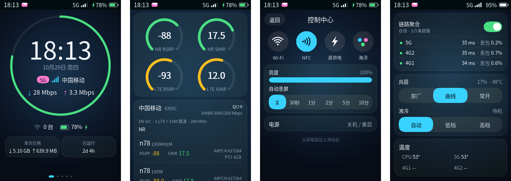

# zwrt-devui

[简体中文](README.md) | **English**

An open-source reimplementation of the front-panel screen UI on 5G pocket Wi-Fi devices. The program only renders; every page is HTML/CSS, so changing the UI needs no rebuild.



## Features

- **UI as data**: pages live in `/data/plugins/zwrt-devui/ui`; edited HTML shows up within about a second.
- **One static binary**: a static aarch64 ELF with no runtime dependencies, built on plain DRM/KMS and evdev.
- **Live data**: device state comes from the companion backend [zwrt-datad](https://github.com/33333s/zwrt-datad), which also carries device controls.
- **Complete stock UI**: home, signal, functions, charts and settings pages; control center, SMS, Wi-Fi, band lock, lock screen and power menu; four themes.
- **Wallpaper and liquid glass**: set a wallpaper from the plugin; buttons are translucent liquid glass with adjustable transparency.
- **External display API**: other local programs can borrow the screen, see [DEVUI-IPC](docs/DEVUI-IPC.md) (Chinese).

## Supported devices

| Device | Model | Notes |
| --- | --- | --- |
| U60 Pro | MU5250 | Default UI |
| TopFlow | MU5252 | Per-modem signal cards, link aggregation, fan and liquid cooling controls |

The model is detected automatically; model-specific pages are picked by file name.

## Install

Install the backend [zwrt-datad](https://github.com/33333s/zwrt-datad) first. Download `zwrt-devui-aarch64` and `ui.tar.gz` from [Releases](https://github.com/33333s/zwrt-devui/releases), copy them together with [`scripts/start.sh`](scripts/start.sh) to `/data/plugins/zwrt-devui/` on the device, then:

```sh
cd /data/plugins/zwrt-devui
mv zwrt-devui-aarch64 zwrt-devui && chmod 755 zwrt-devui
mkdir -p ui && tar -xzf ui.tar.gz -C ui
sh start.sh
```

`start.sh` stops the stock screen program and starts zwrt-devui. For autostart, run [`scripts/install-autostart.sh`](scripts/install-autostart.sh).

## Custom UI

Each top-level `NN-name.html` is a page; `{{TOKENS}}` are replaced with live data and `href="act:xxx"` triggers actions. See [docs/UI-GUIDE.md](docs/UI-GUIDE.md) (Chinese).

## Build

On Linux:

```sh
bash scripts/_setup_toolchain.sh   # aarch64 musl toolchain (once)
bash scripts/_build_freetype.sh    # static FreeType (once)
bash scripts/_build_litehtml.sh    # static litehtml (once)
bash scripts/build.sh              # produces ./zwrt-devui and ./zwrt-devui.stripped
```

`bash tests/ui/preview.sh OUT_DIR` renders every page on a desktop machine.

## Community

QQ group **625439164**

## License

[MIT](LICENSE). litehtml (BSD), FreeType (FTL) and stb (public domain) are used under their own licenses.
